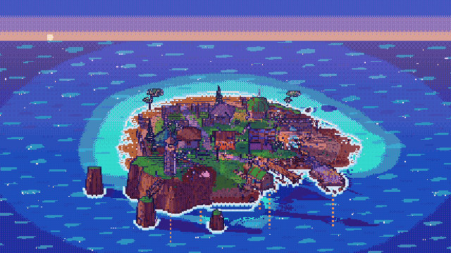
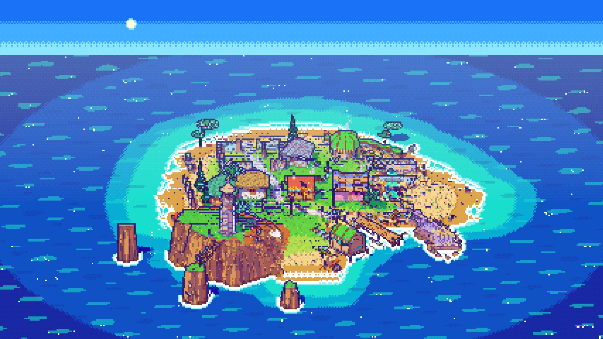
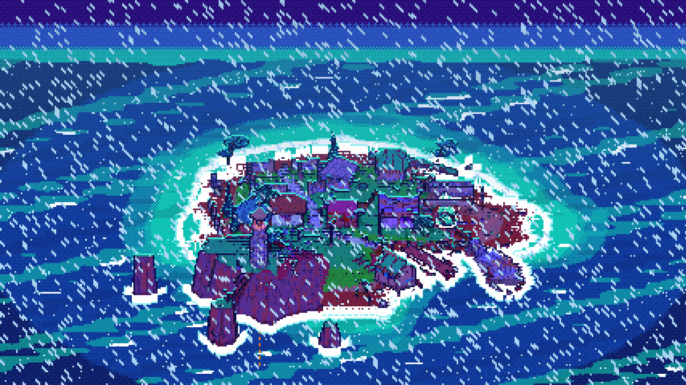
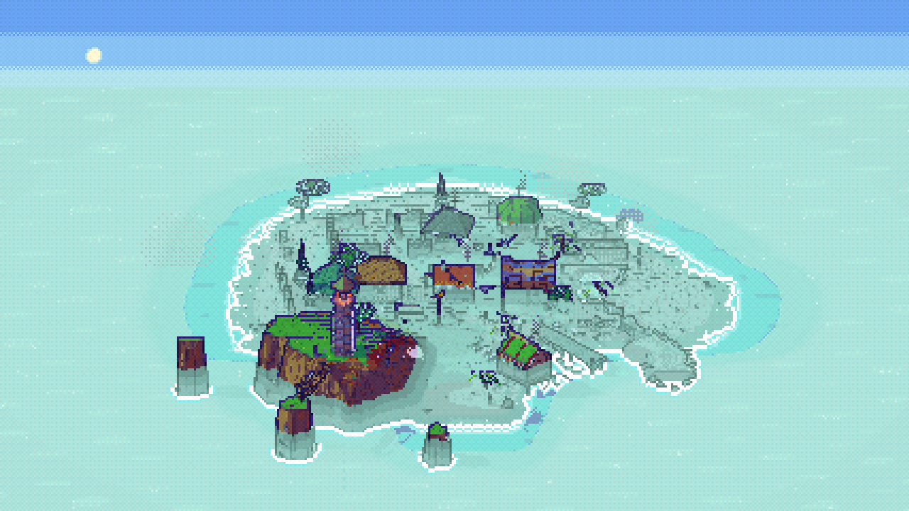
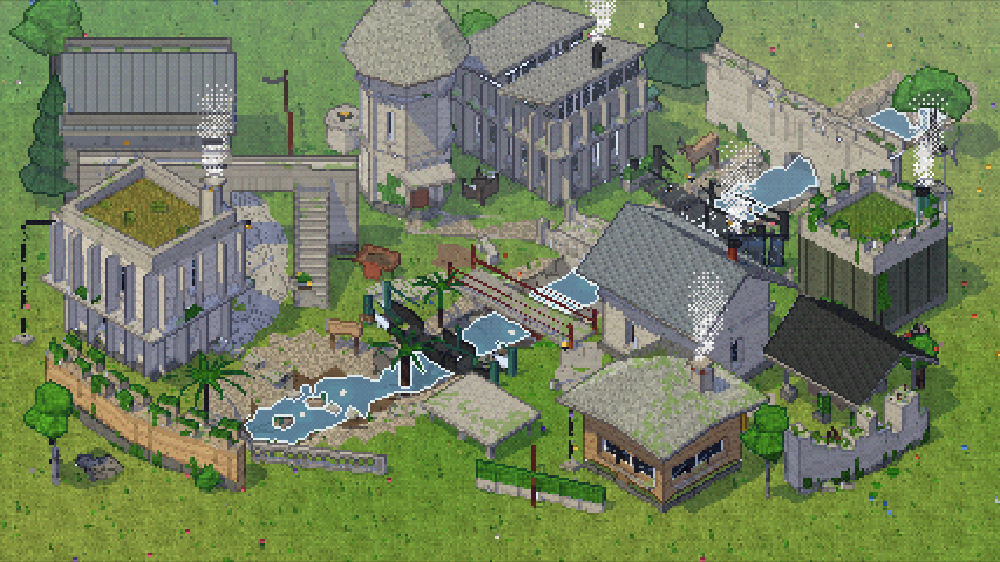
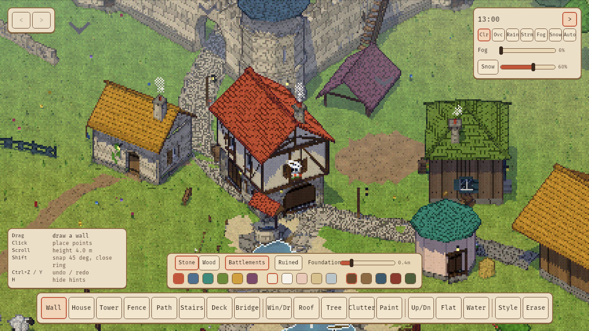

# Tiny Cove



The main project in this repository is **Tiny Cove**. It is a cozy, goal-free
island builder written in Rust with Bevy, with a PS1-style cel-shaded look,
sharp light and six kinds of weather.

**[Watch the footage (MP4, 87 s)](tiny-cove/docs/footage/tiny-cove.mp4)** ·
**[Read the Tiny Cove README](tiny-cove/README.md)**

```sh
cd tiny-cove
cargo run --release -- --demo   # start in the showcase cove
```

| noon | storm | sea fog |
|---|---|---|
|  |  |  |

## Foundational experiments

Tiny Cove grew out of these two. Both are cozy builders with the
same PS1 cel renderer, and each is a standalone Cargo workspace
(`cd experiments/<name> && cargo run --release`). They are no longer developed.

| [`greywild`](experiments/greywild) | [`thistle-glade`](experiments/thistle-glade) |
|---|---|
|  |  |
| Eco-brutalist valley builder: board-formed concrete taken back by moss and birch. Tiny Cove's engine is a fork of it. | Medieval glade builder with walls, houses, towers, sheep and ducks. |

Tiny Cove and both experiments share one build cache in `target/` at the
repository root.

## Archive

[`archive/`](archive) holds two early prototypes, `hollow-acre` and
`concrete-glade`. They are frozen: kept for history, not built or maintained.
