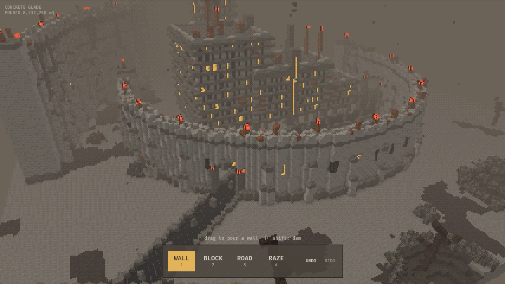

# CONCRETE GLADE

Tiny Glade, except the glade is dead and what you build are brutalist
megastructures. Draw a line and a wall gets poured: buttresses, slit windows,
crenellated walkway and lamps. Drag a rectangle and raise it into a block with
pilotis, floor slabs, a grid of windows (a few still lit), a stair core and
antennas on the roof. Blocks that overlap merge into one mass. A road dragged
through a wall cuts a gate, and grey figures shuffle along it in single file.

Everything is voxels and goes through a PS1-style renderer: a 240p internal
target upscaled with nearest-neighbour, vertices snapped to the pixel grid,
affine texture warp, 15-bit color with Bayer dithering, and thick brown fog.



## Run

```sh
cargo run --release
cargo run --release -- --seed 42                # pick the terrain seed
cargo run --release -- --demo-shot out.png      # scripted scene, screenshot, exit
```

Linux needs the usual Bevy system packages: `libasound2-dev libudev-dev
libxkbcommon-dev libxkbcommon-x11-0 libwayland-dev`. Rust 1.97.1 or newer
(Bevy 0.20).

Headless (no GPU), using Mesa's lavapipe:

```sh
VK_ICD_FILENAMES=/usr/share/vulkan/icd.d/lvp_icd.json WGPU_BACKEND=vulkan \
  xvfb-run -s "-screen 0 1280x720x24" cargo run --release -- --demo-shot out.png
```

## Controls

| Input | Action |
|---|---|
| `1` Wall | drag to pour a wall; hold Shift for a dam |
| `2` Block | drag a footprint, move the mouse to raise it, click to cast |
| `3` Road | drag to lay a road; it cuts gates through anything in its way |
| `4` Raze | drag over structures to demolish them |
| Right-drag / Q, E | orbit |
| Scroll | zoom |
| WASD, arrows, middle-drag | pan |
| Ctrl+Z / Ctrl+Y (Ctrl+Shift+Z) | undo / redo |
| Esc | cancel the current drag |
| N | new world |
| F12 | screenshot to `screenshots/` |

## How it works

The world is a list of structures (walls, blocks, roads) plus a seed. From that
list, `generate` deterministically rebuilds a 160×64×160 voxel grid. Terrain is
generated first, then walls and blocks in placement order, then roads, which
carve through what is there. Undo is a stack of structure lists. Decoration
randomness hashes the seed and voxel position, never the structure's id, so the
live ghost preview you see while dragging matches what gets committed.

The mesher culls hidden faces per 16³ chunk and bakes face shade and ambient
occlusion into vertex colours. Only chunks that changed (and their neighbours)
are remeshed. This is the Townscaper idea applied to voxels: the meshing only
sees occupancy, so separate structures merge into one building.

| File | Role |
|---|---|
| `src/structure.rs` | editable document, undo/redo |
| `src/generate.rs` | terrain and structure rules |
| `src/voxel.rs` | grid, coordinates, chunk diff |
| `src/mesher.rs` | chunk → mesh buffers |
| `src/render/` | PS1 material, low-res target, atlas, screenshots |
| `src/scene.rs` | document → grid → chunk entities |
| `src/tools.rs` | tool state machine, picking |
| `src/camera.rs` | orbit camera |
| `src/ui.rs`, `src/ambience.rs` | HUD; ash, smoke, figures |

`cargo test` covers generation, meshing, undo, the tool state machine and
picking.
