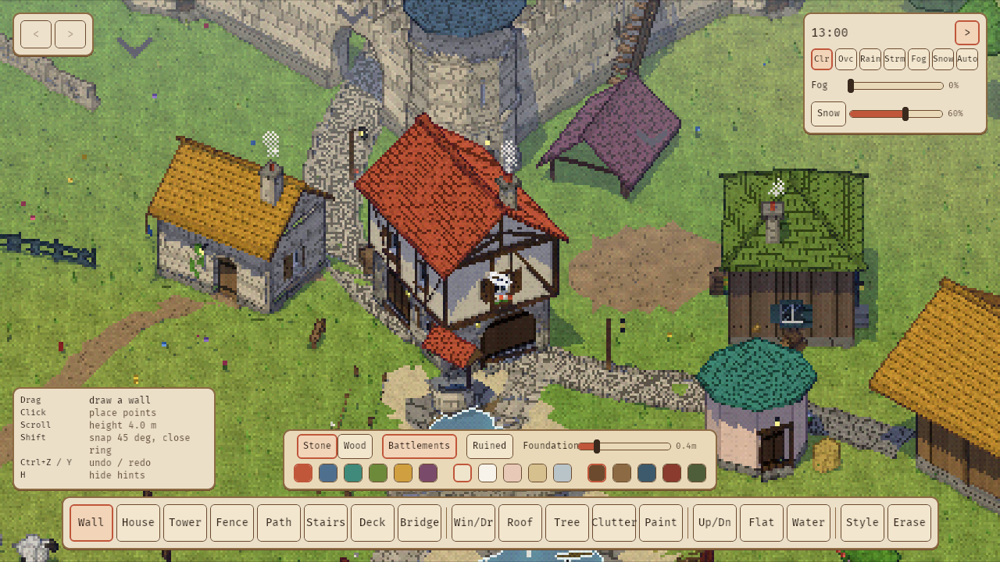

# THISTLE GLADE

A cosy medieval glade builder in the spirit of Tiny Glade, in Rust and Bevy 0.20.
There are no goals. You draw walls, houses, towers, fences and paths onto a small
grassy glade, and the game fills in the stones, windows, doors, chimneys,
battlements, ivy and lanterns. Sheep graze, birds circle and land on the roofs,
chimneys smoke, ducks paddle on the ponds and fireflies come out at night.

It renders like a PlayStation 1 game wearing Tiny Glade's palette:
- a 240-pixel-tall internal image upscaled with nearest-neighbour
- vertices snapped to that low-res grid, so geometry wobbles
- affine (warping) textures, all generated procedurally
- 15-bit colour with Bayer dithering
- distance fog

Lighting is cel-shaded in three hard bands, with crisp shadows from a real sun
(cool-tinted in the shade) and 1-pixel outlines. A day/night clock and weather run
on their own: clear, overcast, rain, storm with lightning, fog and snow.



## Run

```sh
cargo run --release                      # empty glade
cargo run --release -- --demo            # start with the demo glade
cargo run --release -- --showcase        # every primitive variant in a grid
cargo run --release -- --demo-shot out.png --time 19 --weather rain [--yaw 225 --zoom 0.8 --focus X,Z]
cargo test -p glade_core                 # core tests (geometry, scene, undo)
cargo test --release --lib               # game-side tests
```

Weather names: `clear`, `overcast`, `rain`, `storm`, `fog`, `snow`. `--time` is hours 0–24.

Linux needs the usual Bevy packages (`libasound2-dev libudev-dev libxkbcommon-dev
libwayland-dev`). The build shares `../../target` with the other projects in this repo.

Headless, with Mesa's software Vulkan driver:

```sh
VK_ICD_FILENAMES=/usr/share/vulkan/icd.d/lvp_icd.json WGPU_BACKEND=vulkan \
  xvfb-run -a -s "-screen 0 1280x720x24" cargo run --release -- --demo-shot out.png
scripts/drive-ui.sh ../../target/release/thistle_glade   # real mouse/keyboard smoke test (xdotool)
```

## Tools

Primitives ported from Tiny Glade's 1.16 tool set:

| Key | Tool | What it does |
|---|---|---|
| 1 | Wall | Drag a line to draw a stone or wood wall, with battlements, a ruined top or a foundation. A path through it cuts an arched gate. Close the ring to roof it. |
| 2 | House | Drag a footprint, move the mouse up to raise it, click to place. Stone, plaster or wood; half-timbering; gable, hip, cone or flat roof. Windows, a door and a chimney appear automatically. Very low walls make a shelter. |
| 3 | Tower | Drag a circle and raise it: a cone or crenellated top with arrow slits. |
| 4 | Fence | Wooden rail, picket, dry-stone or wattle. |
| 5 | Path | Dirt, cobble, flagstone or setts. Crossing water makes stepping stones. |
| 6 | Stairs | Drag from low to high: wooden stairs, stone steps or a ladder. |
| 7 | Deck | Wooden platform on posts. |
| 8 | Bridge | Rope bridge (four railing styles, optional lanterns or flags), stone arch or wooden trestle. |
| 9 | Window/Door | Click a wall to add a window. Click again for a door, then a wide doorway. Shift-click removes. |
| 0 | Roof | Click a closed wall ring to roof it, or a house to apply the selected roof style. Alt+scroll changes pitch. |
| G | Tree | Oak, pine, birch or fruit tree. Alt+scroll rotates. |
| C | Clutter | Barrel, crate, haystack, well, cart, bench, lantern post, flag pole, washing line, woodpile, rock, bush, beehive, scarecrow. |
| P | Paint | Flowers, bushes, grain or dirt, plus an eraser. |
| R | Raise/Lower | Sculpt the ground (Shift lowers). |
| F | Flatten | Level the ground to the height where the stroke started. |
| V | Water | Carve ponds and streams. |
| I | Style | Click to copy a structure's style; Shift-click to apply it. |
| X | Erase | Click or drag over structures to remove them. |

## Controls

| Input | Action |
|---|---|
| LMB drag / click | use the current tool |
| Scroll | zoom (with Alt: the tool's variant, rotation or pitch) |
| Esc, RMB tap | cancel the current gesture |
| RMB drag, Q / E | orbit (Q/E turn in 45° steps) |
| WASD, arrows, MMB drag | pan |
| PageUp / PageDown | tilt |
| Home | reset the camera |
| Ctrl+Z, Ctrl+Y / Ctrl+Shift+Z | undo / redo |
| T, `[` / `]` | pause the clock, step one hour back / forward |
| H | hide or show the hints panel |
| F12 | screenshot to `screenshots/` |

The HUD has the same tools, a strip of variants and colour swatches for the current
tool, a weather and time panel, and undo/redo buttons.

## How it works

The world is a seed plus an ordered list of terrain brush dabs and structures (the
`Document`). Undo is a stack of documents. `glade_core::build` turns a document into
meshes, and it is pure and deterministic:
- the terrain is a heightfield with water and paint layers
- every structure has its own procedural generator
- interactions are resolved in the scene step: paths cut gates through walls, doors
  through houses and gaps in fences; houses level the ground under them

Decoration randomness hashes the world position, never an index, so the live preview
while you drag is exactly what you get when you commit. Rebuilds are incremental: a
preview only regenerates what changed (about 9 ms for one moved prop, against about
20 ms for the whole demo glade).

| Path | Role |
|---|---|
| `core/` | `glade_core`: model + undo, terrain, walls/fences, houses/towers/roofs, paths/stairs/bridges, trees/clutter/scatter, scene + picking. No Bevy. |
| `src/render/` | PS1 + cel renderer: low-res target, `GladeMaterial`/`WaterMaterial`/`ParticleMaterial`, procedural atlas, outline post-pass |
| `src/world.rs` | document → entities sync, lantern lights |
| `src/tools/`, `src/ui/` | every tool, the live preview and the HUD |
| `src/camera.rs` | isometric orbit/pan/zoom rig |
| `src/weather.rs` | day/night palette, weather blending, rain/snow/lightning |
| `src/life.rs` | sheep, birds, chimney smoke, fireflies, ducks |
| `src/shot.rs` | CLI and headless demo shots |

Not ported from Tiny Glade: group select/move/rotate, Steam Workshop and the mod editor.
