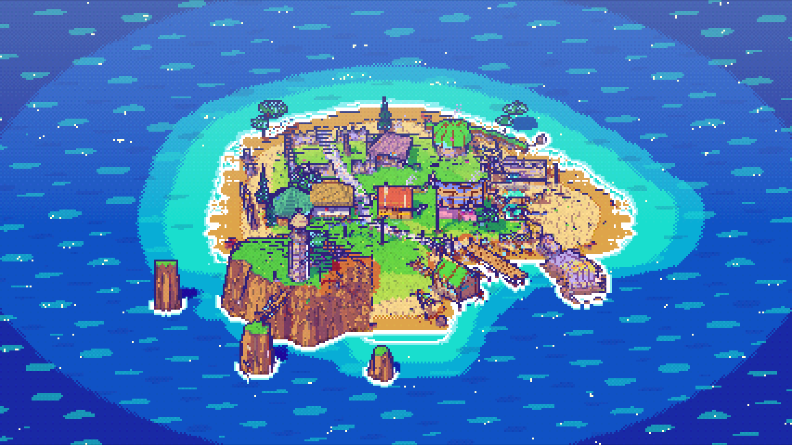
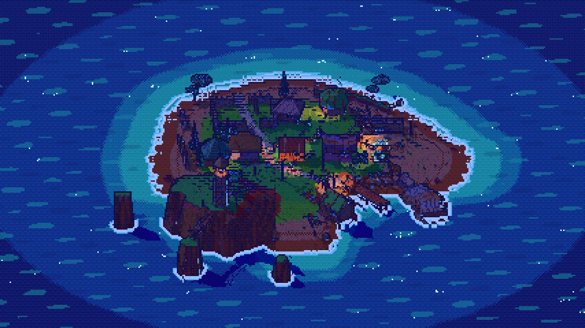
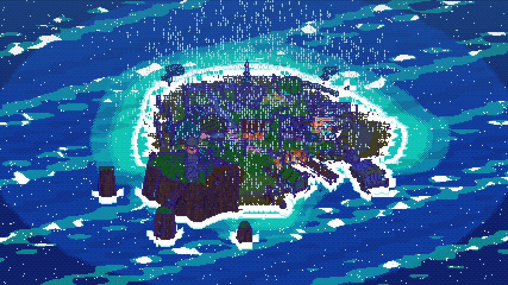
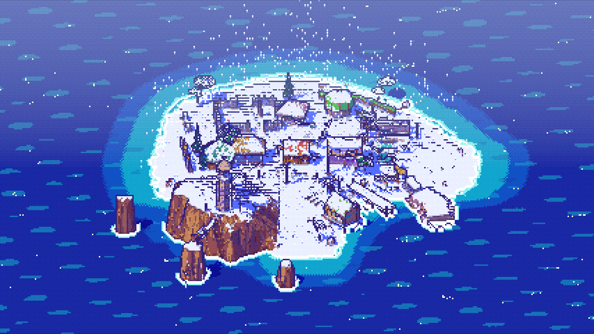
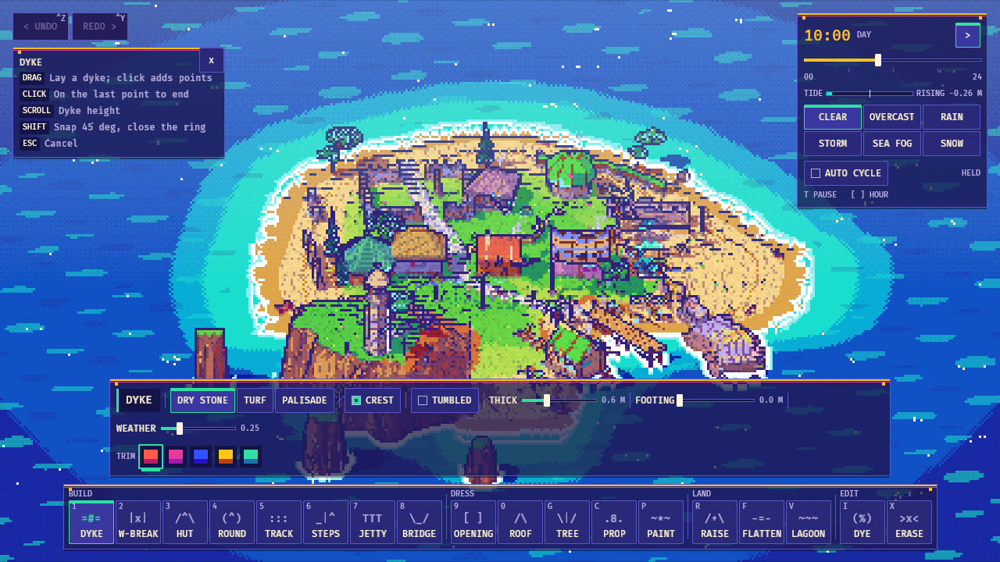

# GREYWILD

A cozy builder in the spirit of Tiny Glade, set in an eco-brutalist valley.
Board-formed concrete is the building primitive, and moss, ferns, birch and
water are slowly taking it back. There are no goals and no way to fail: drag
out walls, blocks, silo towers, paths, stairs, decks and bridges, and the game
fills in the details. Those include formwork texture, slot windows, fins,
planters, ivy, rain chains, vent stacks and solar arrays.

The renderer imitates a PS1: a 240 px target upscaled with nearest-neighbour,
vertex snapping, affine textures and a 15-bit Bayer dither. On top of that it
adds hard cel bands, sharp sun shadows, 1-px outlines, a day/night cycle and
weather: clear, overcast, rain, storm, fog and snow.

Built with Rust and Bevy 0.20. `SPEC.md` has the full list of primitives and
how each Tiny Glade tool maps to them. `DESIGN.md` is the HUD brief.



| dusk rain | night | storm |
|---|---|---|
|  |  |  |
| **snow** | **fog** | **HUD** |
|  |  |  |

## Run

```sh
cd greywild
cargo run --release            # empty valley
cargo run --release -- --demo  # start in the showcase valley
```

The Linux build needs `libudev-dev`, `libasound2-dev`, `libwayland-dev` and
`libxkbcommon-dev`. The build cache is shared with the sibling projects through
`../target`.

## Controls

| Input | Action |
|---|---|
| `1`–`0`, `G C P R F V I X` / toolbar | wall, fence, block, tower, path, stairs, deck, bridge, window/door, roof, tree, clutter, paint, raise, flatten, water, style, erase |
| LMB drag | draw; for blocks and towers, drag the footprint, move the mouse to raise it, then click to cast |
| Scroll while drawing | wall height, roof style or pitch, rotation |
| Shift | 45° snap, lower terrain, remove opening, apply style |
| Ctrl+Z / Ctrl+Y | undo / redo |
| Esc / RMB tap | cancel |
| RMB drag, Q/E | orbit (45° steps) |
| Scroll, WASD / MMB drag, PgUp/PgDn | zoom, pan, tilt |
| T, `[` `]` | pause time, scrub the hour |
| H | hide or show hints |

## Verify

```sh
cargo test --release --workspace
cargo build --release
# headless (Mesa lavapipe + Xvfb):
export VK_ICD_FILENAMES=/usr/share/vulkan/icd.d/lvp_icd.json WGPU_BACKEND=vulkan
xvfb-run -a -s "-screen 0 1280x720x24" ../target/release/greywild --demo-shot out.png --time 18.5 --weather rain [--hud]
xvfb-run -a -s "-screen 0 1280x720x24" ../target/release/greywild --tool-smoke smoke.png   # drives all 18 tools, exits 0 on pass
```

## Layout

- `core/` is the `greywild_core` crate and has no Bevy dependency. It holds the
  document and undo history, the terrain, and the procedural meshes for every
  primitive (`walls`, `buildings`, `paths`, `nature`). It is deterministic and
  unit-tested.
- `src/` holds the Bevy side:
  - `render` (PS1/cel material, atlas, post)
  - `world` (scene sync)
  - `tools` (input for every primitive and `--tool-smoke`)
  - `ui` (HUD)
  - `weather`
  - `life` (deer, swifts, ducks, steam, fireflies)
  - `camera`
  - `shot`
