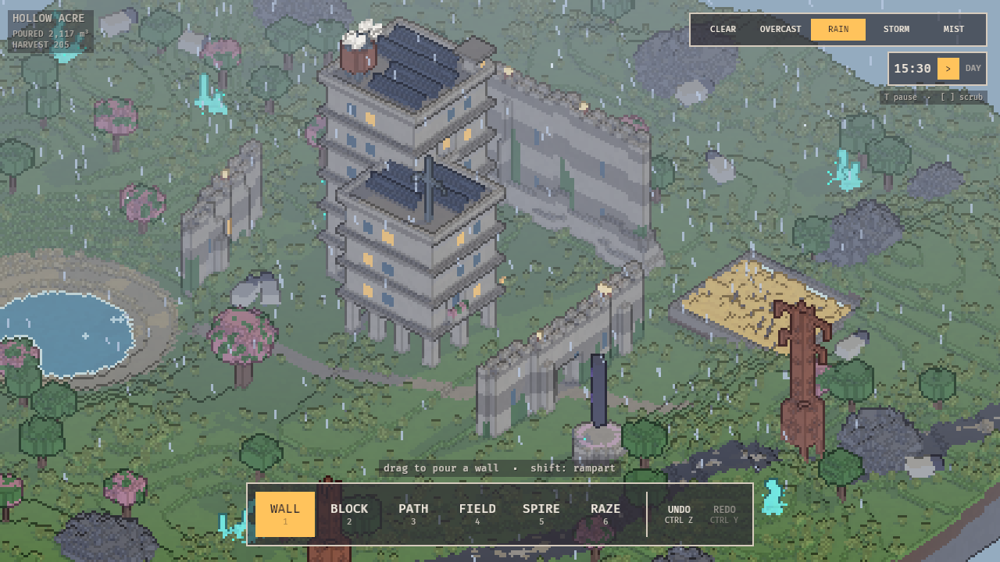

# HOLLOW ACRE

A small building toy in the spirit of Tiny Glade. A century after the end of the
world, the farmland has grown back over the highways, and stranger things grew
with it: aether crystals, rune monoliths that hover over their plinths, wheat that
glows at night. You pour brutalist concrete into it. Draw a line and get a
buttressed wall with slit windows, ivy and lamps. Drag a footprint, raise it, and
get a terraced block with pilotis, balconies full of planters, solar panels and a
water tank. Blocks that touch merge into one mass. A path drawn through a wall
cuts an arched gate. There are no goals.

It renders as pixel art: an orthographic isometric camera draws the scene at
about 270 px tall and upscales it with nearest-neighbour. Lighting is cel-shaded
in three hard bands with a real shadow-casting sun, cool blue-violet shadows and
1-pixel outlines from a depth/normal pass. A day/night cycle and weather (clear,
overcast, rain, storm with violet lightning, mist) run on their own. Robot sheep
graze, fireflies come out over the wheat, and steam drifts off the roofs.



## Run

```sh
cargo run --release
cargo run --release -- --seed 42                                # pick the terrain seed
cargo run --release -- --demo-shot out.png                      # scripted scene, screenshot, exit
cargo run --release -- --demo-shot out.png --time 22 --weather clear
```

Weather names: `clear`, `overcast`, `rain`, `storm`, `mist`. `--time` is hours 0–24.

Linux needs the usual Bevy system packages (`libasound2-dev libudev-dev
libxkbcommon-dev libwayland-dev`). Bevy 0.20 needs a recent stable Rust.
The build shares `../target` with the other projects in this repo
(see `.cargo/config.toml`), so the binary lands in `../target/release/`.

Headless, with Mesa's software Vulkan driver:

```sh
VK_ICD_FILENAMES=/usr/share/vulkan/icd.d/lvp_icd.json WGPU_BACKEND=vulkan \
  xvfb-run -a -s "-screen 0 1280x720x24" cargo run --release -- --demo-shot out.png
```

## Controls

| Input | Action |
|---|---|
| `1` Wall | drag to pour a wall; hold Shift for a tall rampart |
| `2` Block | drag a footprint, move the mouse up to add floors, click to cast |
| `3` Path | drag a gravel path; it cuts gates through walls and blocks |
| `4` Field | drag a field of luminous wheat |
| `5` Spire | click to place a landmark; Tab cycles crystal / monolith / blossom tree |
| `6` Raze | drag over structures to demolish them |
| Right-drag, Q / E | orbit |
| Scroll | zoom |
| WASD, arrows, middle-drag | pan |
| Ctrl+Z / Ctrl+Y (Ctrl+Shift+Z) | undo / redo |
| Esc, right-click | cancel the current drag |
| T, `[` / `]` | pause time, scrub an hour |
| N | new world |
| F12 | screenshot to `screenshots/` |

The HUD has the same tools plus a weather picker and the clock.

## How it works

The world is a seed plus an ordered list of structures. `acre_core::generate`
rebuilds a 192×64×192 voxel grid from that list every time it changes: terrain
first, then fields, walls, blocks and spires, then paths, which carve. It takes a
couple of milliseconds, so while you drag, the pending structure is simply
appended and the world regenerated: the preview is the real result. Decoration
randomness hashes world position, never the structure's index, so what you see
while dragging is what you get. Undo is a stack of documents.

Only chunks that changed are remeshed. The mesher sees nothing but occupancy,
which is why two blocks merge into one building.

| Path | Role |
|---|---|
| `core/` | `acre_core`: voxels, structures, undo, generation, mesher (no Bevy) |
| `src/game.rs` | shared resources and messages between the systems below |
| `src/render/` | low-res target, toon material, outline pass, palette, atmosphere |
| `src/camera.rs` | orthographic orbit camera, cursor ray |
| `src/scene.rs` | document → grid → chunk meshes |
| `src/tools.rs` | tool gestures, picking, undo/redo |
| `src/weather.rs` | clock, weather, rain, lightning |
| `src/life.rs` | sheep, fireflies, steam, motes, floating monoliths |
| `src/ui.rs` | HUD |
| `src/demo.rs`, `src/shot.rs` | scripted demo scene, CLI, screenshots |

`cargo test --workspace` covers generation, carving, meshing, undo, the tool
gesture state machine, picking, weather mapping and HUD text.

`SPEC.md` is the spec and `DESIGN.md` the visual brief.
