# TINY COVE

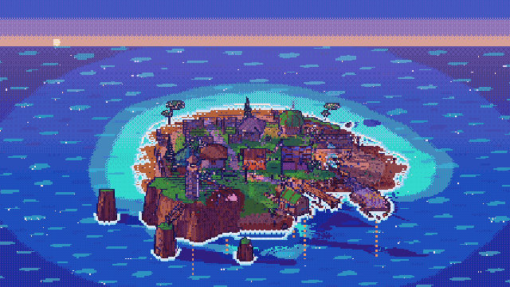

**[Watch the footage (MP4, 87 s)](docs/footage/tiny-cove.mp4)**: a day passing,
the harbour at golden hour, a weather tour, the island at night, and a scripted
build run with the HUD.

Tiny Cove is a cozy builder with no goals, set on a small sunlit island where you
make a home for a seafaring people. You drag out dry-stone dykes, thatched huts,
roundhouses, beacon towers, shell tracks, cliff steps, jetties and rope bridges.
The game adds the details: lashings, hanging fish, shutters, smoke holes,
mooring posts and stilts. The tide comes in and goes out twice a day. Gulls ride
the wind, crabs work the waterline and canoes bob at the jetties. At night the
beacons are lit.

It looks like a PS1 game. The scene renders to a 240-row target and is scaled up
by a whole-number factor. Vertices snap to that grid, textures are affine, and
colour is 15-bit with a Bayer dither. Lighting uses three cel bands with
violet-tinted shadows, sharp sun shadows and 1-px outlines. The palette is
deliberately loud: turquoise shallows, saffron sand, lime grass, golden thatch,
and madder, woad and cochineal paint.

It is built with Rust and Bevy 0.20. `SPEC.md` describes the game and its
building kit, `DESIGN.md` sets the art and HUD rules, and `TASKS.md` is the
build log.

## Footage

Every frame below comes from the game itself. A `--record` mode advances game
time exactly 1/30 s per frame and saves each one, so the video plays at true
game speed even though this container renders in software (see
[Recording footage](#recording-footage)).

| A day in 12 s | Harbour, golden hour |
|---|---|
| 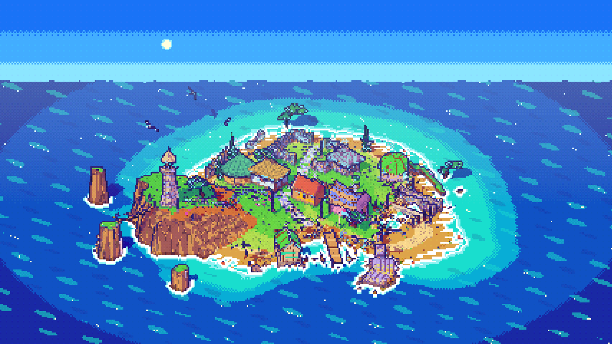 | 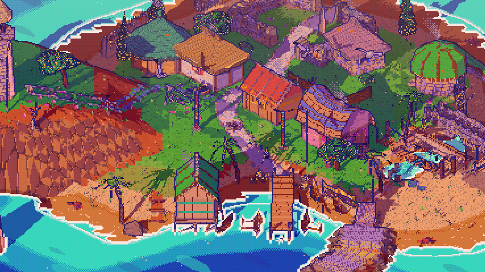 |
| **Weather tour** | **Night** |
| 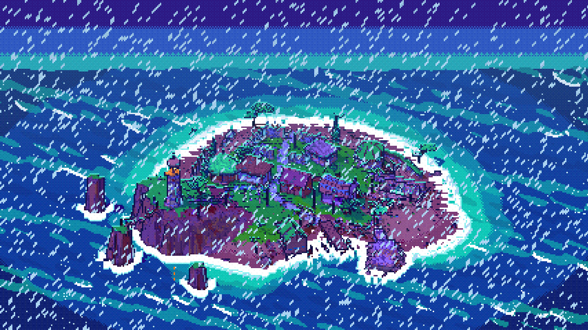 | 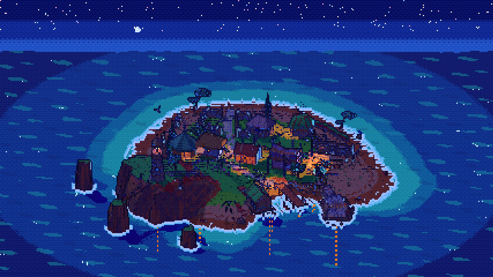 |
| **Build run (HUD)** | **Day, dusk** |
| 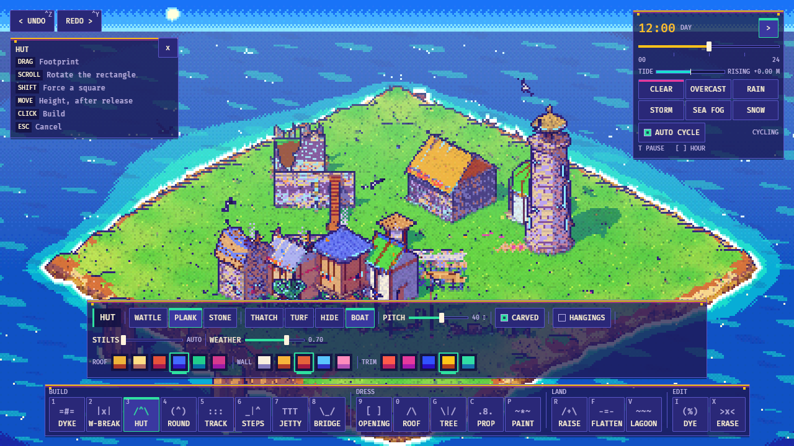 | 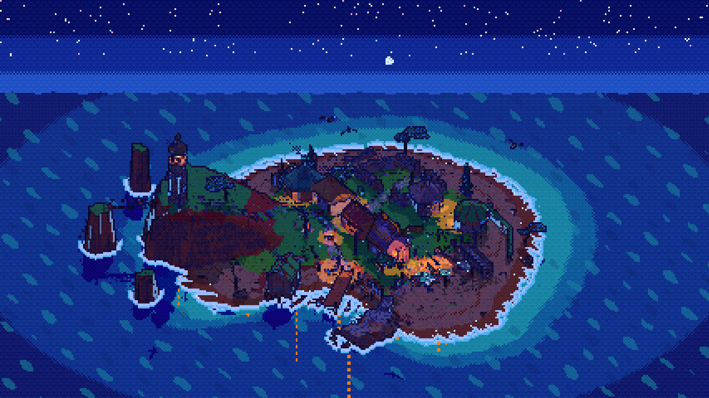 |

All 15 stills are in [`docs/footage/stills`](docs/footage/stills).

## Weather

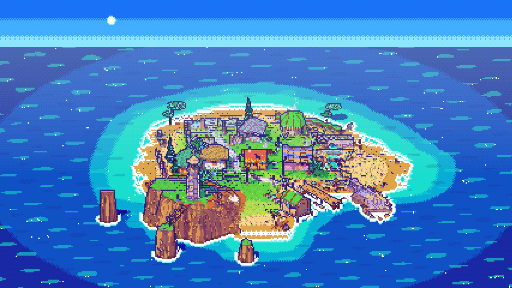

| dusk rain | night | storm |
|---|---|---|
| 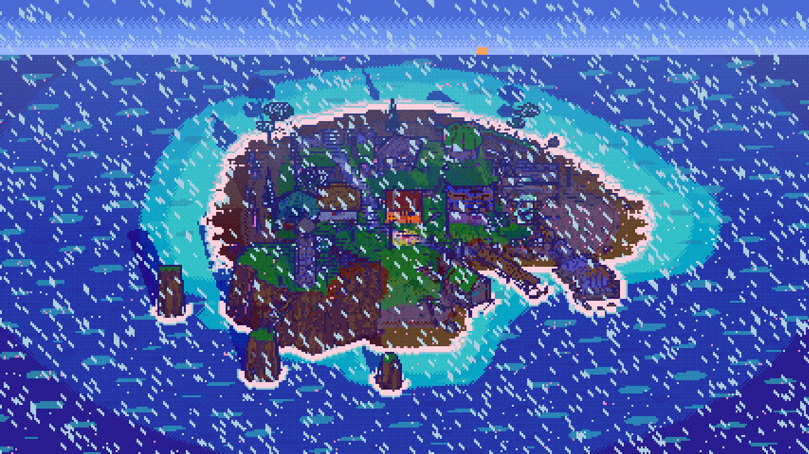 | 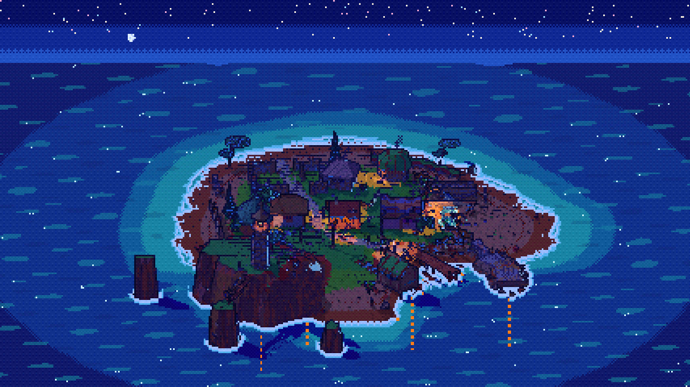 | 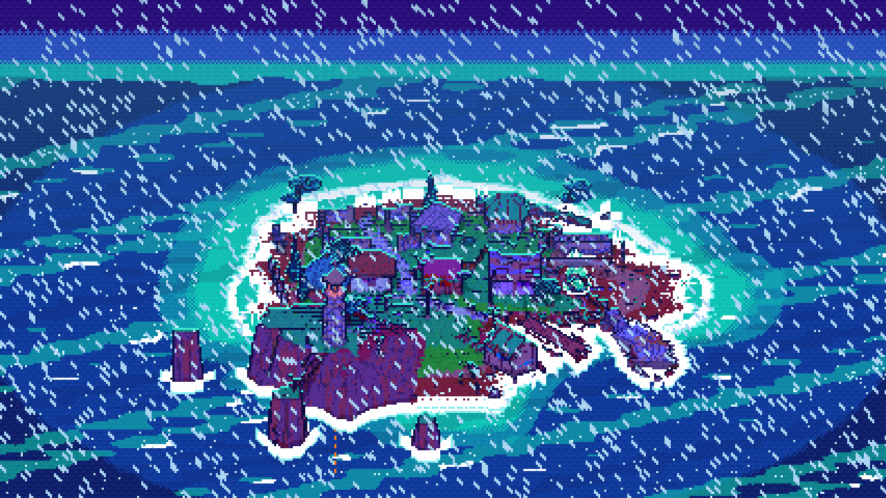 |
| **sea fog** | **snow** | **HUD** |
| 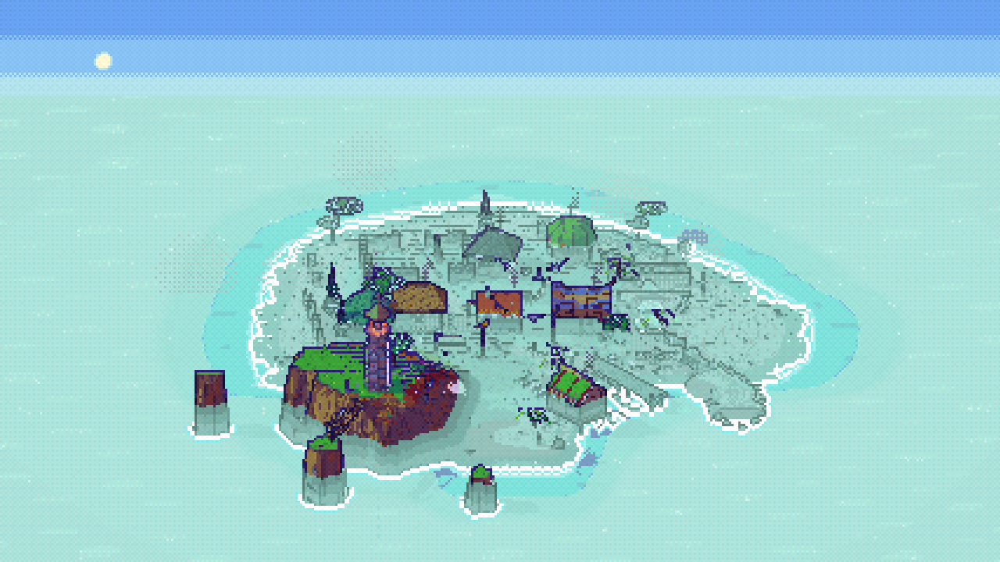 | 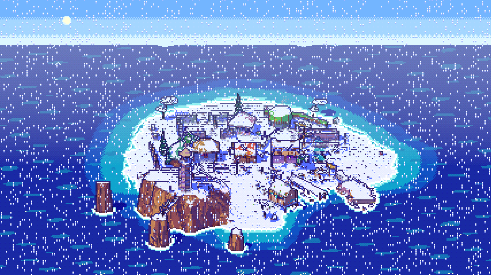 | 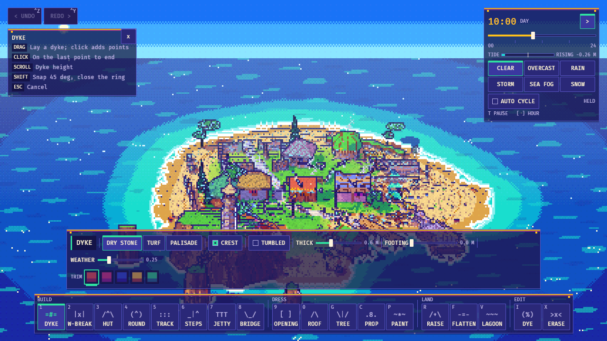 |

- **Clear** follows the sun: cobalt at noon, tangerine at dusk, then moon and stars.
- **Rain** darkens the sand to wet honey, and slanted streaks follow the wind.
- **Storm** turns the land plum, violet and jade under a cobalt light. Cyan
  hairlines trace every ridge and lightning flashes. The lit beacon is the only
  warm point.
- **Sea fog** is a mint, pearl and lilac bank about 3 m deep. Roofs, palms and
  the beacon rise out of it in their own colours.
- **Snow** covers what faces up. Trim paint keeps its full colour.

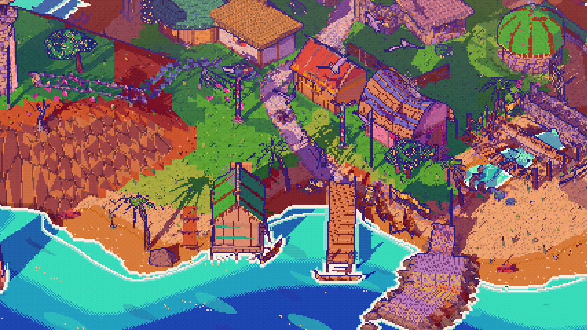

## Run

```sh
cd tiny-cove
cargo run --release            # empty island
cargo run --release -- --demo  # start in the showcase cove
```

On Linux the build needs `libudev-dev`, `libasound2-dev`, `libwayland-dev` and
`libxkbcommon-dev`, plus Rust 1.97.1 or newer. The build cache is shared with the
sibling projects through `../target`.

## Building kit

| Key | Tool | What you get |
|---|---|---|
| 1 | Dyke | Dry-stone, turf or palisade wall. Over the sea it becomes a breakwater. A track through it leaves a gap with standing-stone gateposts. |
| 2 | Windbreak | Wattle, driftwood rail, net line or reed screen. Tracks cut gaps through it. |
| 3 | Hut | Longhut in wattle-and-daub, plank or stone, with a thatch, turf, hide or upturned-boat roof. It stands on stilts over water or steep ground. |
| 4 | Round | Roundhouse. Raised tall, it becomes a beacon tower with a fire basket. |
| 5 | Track | Crushed shell, pebbles, flagstones, boardwalk or stepping stones |
| 6 | Steps | Cut stone, log steps or rope ladder |
| 7 | Jetty | Plank deck on piles, with mooring posts and canoes alongside |
| 8 | Bridge | Rope bridge (4 railings), driftwood log or stone causeway, with lanterns or pennants |
| 9 | Opening | Cycles through shuttered window, doorway and boat door |
| 0 | Roof | Roofs a closed ring of dyke |
| G | Tree | Sea pine, palm, cypress, fig, bleached snag |
| C | Prop | Canoe, drying rack, firepit, cairn, standing stone, carved pole, net rack, baskets, lantern post, pennant, rock, gorse, crab pots, woodpile |
| P | Paint | Sea pinks, dune grass, wrack, pebbles |
| R / F / V | Raise, Flatten, Lagoon | Shape the island. Hold Shift to lower. |
| I | Dye | Recolour, set material and carving, add salt weathering |
| X | Erase | Remove a structure |

## Controls

| Input | Action |
|---|---|
| LMB drag | Draw. For huts and roundhouses, drag the footprint, move the mouse to raise it, then click. |
| Scroll while drawing | Height, roof style or rotation |
| Shift | 45° snap, lower terrain, remove an opening |
| Ctrl+Z / Ctrl+Y | Undo / redo |
| Esc / RMB tap | Cancel |
| RMB drag, Q/E | Orbit |
| Scroll, WASD / MMB drag, PgUp/PgDn | Zoom, pan, tilt |
| T, `[` `]` | Pause time, scrub the hour |
| H | Hide or show hints |
| F12 | Screenshot |

## Recording footage

```sh
tools/footage.sh                 # every clip: day harbour weather night build
tools/footage.sh harbour night   # just these
tools/footage.sh -s 2 weather    # quick check, clips capped at 2 s
```

The script renders each clip, encodes `docs/footage/tiny-cove.mp4` (H.264,
CRF 29, 1280x720 native pixels) and a GIF under 8 MB, and copies three lossless
stills per clip. Without a display it runs the game under Xvfb on Mesa lavapipe,
at about 0.14 s per frame, so the whole set takes about 10 minutes.

The recorder can be driven directly:

```sh
tiny-cove --record DIR [--seconds S] [--fps F] [--orbit DEG] [--zoom-to Z] \
          [--hours H] [--weathers clear,rain,storm,fog,snow] \
          [--time H] [--weather NAME] [--zoom Z] [--focus X,Z] [--yaw D] [--hud]
tiny-cove --tool-smoke out.png --record DIR   # record the scripted build run
```

`--hours` turns the clip into a time-lapse. Without it the clock runs at normal
game speed. `--weathers` switches weather at even intervals and lets the game
blend between them. The run exits non-zero if any frame is missed or fails to
save.

## Verify

```sh
cargo test --release --workspace
cargo build --release
# headless (Mesa lavapipe + Xvfb):
export VK_ICD_FILENAMES=/usr/share/vulkan/icd.d/lvp_icd.json WGPU_BACKEND=vulkan
xvfb-run -a -s "-screen 0 1280x720x24" ../target/release/tiny-cove --demo-shot out.png --time 18.5 --weather rain [--hud] [--zoom S] [--yaw D]
xvfb-run -a -s "-screen 0 1280x720x24" ../target/release/tiny-cove --tool-smoke smoke.png   # drives all 18 tools, exits 0 on pass
```

## Layout

- `core/` is the `cairn_cove_core` crate and does not depend on Bevy. It is
  deterministic and unit-tested, and holds:
  - the document and undo history;
  - the island terrain;
  - procedural meshes for every primitive (`walls`, `buildings`, `paths`, `nature`).
- `src/` is the Bevy side:
  - `render`: the PS1/cel material, atlas, sea and post-processing;
  - `world`: keeps the scene in sync with the document;
  - `tools` and `ui`: input and HUD;
  - `weather` and `env`: day and night, weather, wind and tide;
  - `life`: gulls, crabs, fish, canoes, smoke, flames and fireflies;
  - `camera`, `shot` and `record`: the camera rig and the screenshot and footage modes.
- `tools/footage.sh` renders and encodes the footage.

## Known issues

- At night in the rain, wet sand reads crimson-wine rather than plum. Around
  20:00 in the rain it sits close to the soil's brick colour.
- Neighbouring huts that the terrace rule keeps apart can leave floors 0.3–0.6 m
  uneven.
- A track through a roofed ring raises the whole ring by about 2 m.

The engine started as a fork of the sibling `greywild` prototype and was rebuilt for
the coast.
